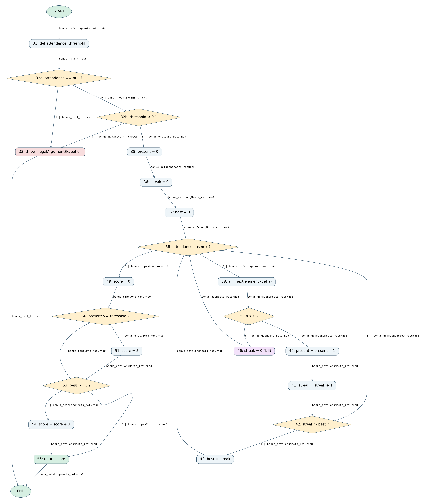
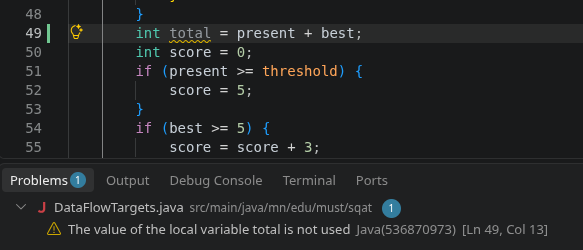

# Лаборатори №10 — Өгөгдлийн урсгалын DU хосууд

**Хичээл:** F.CSA313 — Программ хангамжийн чанарын баталгаа ба тест (2026)  
**Оюутан:** Ө. Анар  
**Оюутны код:** B242270129  
**Тестийн бай:** Багшийн `DataFlowTargets.java` (`gcd`, `bonus`), үндсэн код өөрчлөгдөөгүй.  

## Орчин — терминалын бүтэн гаралт

`java -version`:

```text
openjdk version "21.0.12.1" 2026-08-18
OpenJDK Runtime Environment (build 21.0.12.1+1-1-deb13u1-Debian)
OpenJDK 64-Bit Server VM (build 21.0.12.1+1-1-deb13u1-Debian, mixed mode, sharing)
```

`mvn -version`:

```text
Apache Maven 3.9.9
Maven home: /usr/share/maven
Java version: 21.0.12.1, vendor: Debian, runtime: /usr/lib/jvm/java-21-openjdk-amd64
Default locale: en_US, platform encoding: UTF-8
OS name: "linux", version: "6.12.113+deb13-amd64", arch: "amd64", family: "unix"
```

## Хэсэг A — `gcd()`: def/use болон бүх DU хос

### GCD — All-DU-pairs (starter мөр 13–20)

**Тэмдэглэгээ:** `c` = computational use, `p:T`/`p:F` = predicate-ийн үнэн/худал ирмэг. `tmp` хувьсагчийн 14-р мөрийн declaration нь анхны оноолт биш, definition нь 16-р мөр.

| Хувьсагч | Def | Use | Төрөл | Def-clear зам | Тестийн метод | Хамарсан |
| --- | --- | --- | --- | --- | --- | --- |
| x | 13 | 16 | c | 13→15(T)→16 | gcd_twoLoops_x17_to16 | Тийм |
| x | 13 | 20 | c | 13→15(F)→20 | gcd_zeroLoop_x13_to20 | Тийм |
| x | 17 | 16 | c | 17→18→15(T)→16 | gcd_twoLoops_x17_to16 | Тийм |
| x | 17 | 20 | c | 17→18→15(F)→20 | gcd_twoLoops_x17_to16 | Тийм |
| y | 13 | 15 | p:T | 13→15(T) | gcd_twoLoops_x17_to16 | Тийм |
| y | 13 | 15 | p:F | 13→15(F) | gcd_zeroLoop_x13_to20 | Тийм |
| y | 13 | 16 | c | 13→15(T)→16 | gcd_twoLoops_x17_to16 | Тийм |
| y | 13 | 17 | c | 13→15(T)→16→17 | gcd_twoLoops_x17_to16 | Тийм |
| y | 18 | 15 | p:T | 18→15(T) | gcd_twoLoops_x17_to16 | Тийм |
| y | 18 | 15 | p:F | 18→15(F) | gcd_twoLoops_x17_to16 | Тийм |
| y | 18 | 16 | c | 18→15(T)→16 | gcd_twoLoops_x17_to16 | Тийм |
| y | 18 | 17 | c | 18→15(T)→16→17 | gcd_twoLoops_x17_to16 | Тийм |
| tmp | 16 | 18 | c | 16→17→18 | gcd_twoLoops_x17_to16 | Тийм |

**Дүгнэлт:** `gcd(7,0)` нь давталтад огт орохгүй: `x(13→20)` ба `y(13→15,F)` хосыг заавал хамарна. `gcd(12,8)` нь **2 давталттай** (үлдэгдэл 4, 0), тиймээс `x(17→16)`, `y(18→15,T)`, `y(18→16/17)`, `tmp(16→18)` хосыг хамарна. Хоёр тестийн нийлбэр нь 13 тэмдэглэгдсэн DU/ирмэгийн тохиолдлыг хамарна.


Гаралт: [`results/mvn-verify-gcd.txt`](results/mvn-verify-gcd.txt) — **2** тест, 0 failures, BUILD SUCCESS.

## Хэсэг B — `bonus()`: all-defs → all-DU-pairs

### B — ALL-DEFS эхний шат

`BonusAllDefsTest`-ийн хоёр тестийг сонгов:

- `bonus_defsLongBelow_returns3`: `[1,1,1,1,1,0,1]`, threshold=7, `present=6`, `best=5`; `score(49)` → c-use(54) → `score(54)` → c-use(56). Мөн `streak(46)` → c-use(41) биелнэ.
- `bonus_defsLongMeets_returns8`: `[1,1,1,1,1]`, threshold=5; `score(51)` → c-use(54), `best(43)` → p-use(53,T).

**Яагаад дор хаяж хоёр тест шаардлагатай вэ?** `score(49)`-ийг use хүртэл хүргэх зам болон `score(51)`-ийг use хүртэл хүргэх зам нь нэг ажиллуулалтанд харилцан үл нийцнэ: 51 нь 49-ийн definition-ийг kill хийнэ.  Тиймээс нэг ажиллуулалтаар энэ хоёр definition-ийг хоёуланг нь def-clear use-д хүргэж чадахгүй. Эдгээр хоёр тест нь bonus-ийн бүх хүрч болох definition-үүдийн дор хаяж нэг use-ийг хамардаг.


### All-defs шатны хэмжилт

**4** тест, `BUILD SUCCESS`.

| Хэмжүүр | Covered | Missed | Хамралт |
|---|---:|---:|---:|
| BRANCH | 13 | 3 | 81.25% |
| LINE | 22 | 2 | 91.67% |

Нотолгоо: [`mvn-verify-alldefs.txt`](results/mvn-verify-alldefs.txt), [`jacoco-alldefs.csv`](results/jacoco-alldefs.csv).

### Бүрэн CFG (мөрийн дугаар + ирмэг бүрийн бодит тестийн нэр)



`cfg-bonus.dot`-оос Graphviz-аар экспортлосон диаграм. Эх кодын 32-р мөрийн `||`-ийг 32a/32b тусдаа нөхцөл, 38-р мөрийн for-each-ийг дараагийн элемент байгаа эсэх болон `a`-г шинэчлэн оноох үйлдэл болгон ялгасан. `streak=0` (46-р мөр) нь өмнөх streak-def-ийг kill хийдгийг CFG-д тэмдэглэсэн.

### Bonus — DU анализ, 31–56-р мөрүүд

## Мөр бүрийн def/use (c-use, p-use)

| Мөр | Def | C-use | P-use / салаа |
|---|---|---|---|
|31|`attendance`, `threshold`|–|–|
|32|–|–|`attendance==null`, `threshold<0` (short-circuit тусдаа)|
|33|–|–|– (exception)|
|35|`present`|–|–|
|36|`streak`|–|–|
|37|`best`|–|–|
|38|`a` (элемент бүр), дараах `a` болгонд шинэ def|–|`attendance` (дараагийн элемент байгаа эсэх T/F)|
|39|–|–|`a>0` (T/F)|
|40|`present` (шинэ)|`present` (хуучин)|–|
|41|`streak` (шинэ)|`streak` (хуучин)|–|
|42|–|–|`streak>best` (T/F)|
|43|`best`|`streak`|–|
|46|`streak=0`|–|–|
|49|`score=0`|–|–|
|50|–|–|`present>=threshold` (T/F)|
|51|`score=5`|–|–|
|53|–|–|`best>=5` (T/F)|
|54|`score=score+3`|`score` (хуучин)|–|
|56|–|`score`|–|

## Def-clear DU хосын бүрэн хүснэгт

`…` гэсэн замын тэмдэглэл нь давталт дээр ижил дараалал олон удаа гүйцэтгэгдэж болохыг илэрхийлнэ; тухайн хувьсагчийн шинэ definition байвал тухайн зам def-clear биш. Хүснэгтийн **Тестийн метод** нь `BonusAllDefsTest`/`BonusTest` кодод үнэхээр байгаа нэр.

| Хувьсагч | Def мөр | Use мөр | Төрөл | Def-clear зам | Тестийн метод | Хамарсан |
| --- | --- | --- | --- | --- | --- | --- |
| a | 38 | 39 | p:F | 38(def a)→39(F) | bonus_defsLongBelow_returns3 | Тийм |
| a | 38 | 39 | p:T | 38(def a)→39(T) | bonus_defsLongBelow_returns3 | Тийм |
| attendance | 31 | 32 | p:F | 31→32(attendance=F) | bonus_defsLongBelow_returns3 | Тийм |
| attendance | 31 | 32 | p:T | 31→32(attendance=T) | bonus_null_throws | Тийм |
| attendance | 31 | 38 | p:F | 31→32(F)→35→36→37→38(F) | bonus_defsLongBelow_returns3 | Тийм |
| attendance | 31 | 38 | p:T | 31→32(F)→35→36→37→38(T) | bonus_defsLongBelow_returns3 | Тийм |
| best | 37 | 42 | p:T | 37→38(T)→39(T)→40→41→42(T) | bonus_defsLongBelow_returns3 | Тийм |
| best | 37 | 53 | p:F | 37→38(F)→49→50→53(F) | bonus_absentZero_returns5 | Тийм |
| best | 43 | 42 | p:F | 43(def)→38(T)→39(F)→46→38(T)→39(T)→40→41→42(F) | bonus_defsLongBelow_returns3 | Тийм |
| best | 43 | 42 | p:T | 43(def)→38(T)→39(T)→40→41→42(T) | bonus_defsLongBelow_returns3 | Тийм |
| best | 43 | 53 | p:F | 43(def)→…→38(F)→49→50→53(F) | bonus_gapBelow_returns0 | Тийм |
| best | 43 | 53 | p:T | 43(def)→…→38(F)→49→50→53(T) | bonus_defsLongBelow_returns3 | Тийм |
| present | 35 | 40 | c | 35→36→37→38(T)→39(T)→40 | bonus_defsLongBelow_returns3 | Тийм |
| present | 35 | 50 | p:F | 35→36→37→38(F)→49→50(F) | bonus_emptyOne_returns0 | Тийм |
| present | 35 | 50 | p:T | 35→36→37→38(F)→49→50(T) | bonus_absentZero_returns5 | Тийм |
| present | 40 | 40 | c | 40(def)→41→42→38(T)→39(T)→40(use) | bonus_defsLongBelow_returns3 | Тийм |
| present | 40 | 50 | p:F | 40(def)→…→38(F)→49→50(F) | bonus_defsLongBelow_returns3 | Тийм |
| present | 40 | 50 | p:T | 40(def)→…→38(F)→49→50(T) | bonus_defsLongMeets_returns8 | Тийм |
| score | 49 | 54 | c | 49→50(F)→53(T)→54 | bonus_defsLongBelow_returns3 | Тийм |
| score | 49 | 56 | c | 49→50(F)→53(F)→56 | bonus_emptyOne_returns0 | Тийм |
| score | 51 | 54 | c | 51→53(T)→54 | bonus_defsLongMeets_returns8 | Тийм |
| score | 51 | 56 | c | 51→53(F)→56 | bonus_absentZero_returns5 | Тийм |
| score | 54 | 56 | c | 54→56 | bonus_defsLongBelow_returns3 | Тийм |
| streak | 36 | 41 | c | 36→37→38(T)→39(T)→40→41 | bonus_defsLongBelow_returns3 | Тийм |
| streak | 41 | 41 | c | 41(def)→42→[43]→38(T)→39(T)→40→41(use) | bonus_defsLongBelow_returns3 | Тийм |
| streak | 41 | 42 | p:F | 41(def)→42(F) | bonus_defsLongBelow_returns3 | Тийм |
| streak | 41 | 42 | p:T | 41(def)→42(T) | bonus_defsLongBelow_returns3 | Тийм |
| streak | 41 | 43 | c | 41(def)→42(T)→43 | bonus_defsLongBelow_returns3 | Тийм |
| streak | 46 | 41 | c | 46→38(T)→39(T)→40→41 | bonus_defsLongBelow_returns3 | Тийм |
| threshold | 31 | 32 | p:F | 31→32(att F; threshold F) | bonus_defsLongBelow_returns3 | Тийм |
| threshold | 31 | 32 | p:T | 31→32(att F; threshold T) | bonus_negativeThr_throws | Тийм |
| threshold | 31 | 50 | p:F | 31→32(F)→35→36→37→38…49→50(F) | bonus_defsLongBelow_returns3 | Тийм |
| threshold | 31 | 50 | p:T | 31→32(F)→35→36→37→38…49→50(T) | bonus_defsLongMeets_returns8 | Тийм |

**Kill болон биелэшгүй хосууд:**

- `streak`-ийн 36→42 хос **байхгүй**: 42-р мөрд хүрэхээс өмнө 41-р мөр `streak`-ийг дахин тодорхойлно.
- `streak`-ийн 41→41 хос **46-р мөрөөр дамжвал def-clear биш**: `streak=0` (46) нь 41-ийн өмнөх definition-ийг kill хийнэ. 46→41 хос харин бодит боломжтой.
- `best(37)→42(F)` **биелэшгүй**: анхны эерэг ирцийн дараа `streak=1>best=0` заавал True. Хэрэв `best` өөр болсон бол 43-р мөр 37-ийн definition-ийг kill хийсэн.
- `best(37)→53(T)` **биелэшгүй**: 37-оос хойш 43-р мөрд дахин оноолт хийгдээгүй бол `best=0`, 53-ын нөхцөл False.
- `score(49)→56`, 50(T) зам **def-clear биш**: 51-р мөрд `score=5` дахин тодорхойлно. `score(49)→56` нь зөвхөн 50(F),53(F) замаар боломжтой.
- `threshold` нь `attendance=null` үед 32-ын хоёр дахь нөхцөлд ашиглагдахгүй (short-circuit), учир нь эхний нөхцөл True болсон.

**Бодит хамруулсан DU/ирмэгийн тохиолдол:** 33. `present`, `streak`, `best`, `score`, `attendance`, `threshold`, `a` бүх хувьсагч орсон. `38` дахь `a`-ийн def нь for-each-ийн *элемент бүрд* дахин тодорхойлогдоно.


### All-DU-pairs шат ба эцсийн JaCoCo

Нэмэлт `BonusTest` тестүүдээр `attendance`, `threshold`, `a`, `present`, `streak`, `best`, `score`-ийн **33 DU/ирмэгийн тохиолдлыг** хамарсан. `GcdTest`-ийн 13 тохиолдол мөн хамрагдсан. Энэхүү DU тоо нь гараар/урсгалын моделийн def-clear анализын тоо; JaCoCo түүнийг хэмждэггүй.

All-DU-pairs шатанд **14** тест, `BUILD SUCCESS`.

| Хэмжүүр | Covered | Missed | Хамралт |
|---|---:|---:|---:|
| BRANCH | 16 | 0 | 100.00% |
| LINE | 23 | 1 | 95.83% |

Эцсийн `mvn verify`-д **15** тест, 0 failures/errors, `BUILD SUCCESS`.

| Хэмжүүр | Covered | Missed | Хамралт |
|---|---:|---:|---:|
| BRANCH | 16 | 0 | 100.00% |
| LINE | 23 | 1 | 95.83% |


## Хэсэг C — Fault seeding, бодит Maven үр дүн

| Мутаци | Түр өөрчилсөн код | Maven үр дүн | Унасан тест | Нотолгоо |
|---|---|---|---|---|
| M1 | `streak = streak + 1` мөрийг хассан | 14 test, Failures=4, Errors=0, BUILD FAILURE | `BonusTest.bonus_zeroThrLong_returns8`, `BonusTest.bonus_longBelow_returns3`, `BonusAllDefsTest.bonus_defsLongMeets_returns8`, `BonusAllDefsTest.bonus_defsLongBelow_returns3` | `results/mvn-test-M1.txt` |
| M2 | `best = streak` → `best = present` | 14 test, Failures=0, Errors=0, BUILD SUCCESS | Унасан тест байхгүй | `results/mvn-test-M2.txt` |
| M3 | `int total = present + best` — уншигдахгүй хувьсагч | 15 test, Failures=0, Errors=0, BUILD SUCCESS | Унасан тест байхгүй | `results/mvn-test-M3.txt` |

M2 анхны all-DU-pairs тестүүдийг давж **амьд үлдсэн**. Өмнөх тасралтгүй ирцийн үед `present` болон `streak` хоёул ижил өсөх, тасарсны дараа шинэ богино цуваа өмнөх `best`-ийг даваагүй учраас буруу оноолт илрээгүй. `bonus_restartedStreakMustNotUsePresentForBest` нэмэлт тест нь `[1,1,0,1,1,1]`, threshold=6 өгч, **15 test, Failures=1, Errors=0, BUILD FAILURE** гаргасан (`BonusMutationKillTest.bonus_restartedStreakMustNotUsePresentForBest`). Эх кодыг сэргээхэд зөв буцах утга 0 байна.

**M3 — Dead Definition:** `total` хувьсагчид утга
оноосон боловч дараа нь ашиглаагүй. JUnit-ийн
15 тест PASS болсон тул энэ алдааг динамик тест
илрүүлээгүй. VS Code-ийн статик анализ
ашиглагдаагүй хувьсагчийг анхааруулсан.



**Эх кодыг сэргээсэн нотолгоо:** Мутаци бүрийн дараа `git restore src/main/java/mn/edu/must/sqat/DataFlowTargets.java` хэрэглэж, эцэст нь Maven verify PASS болсон. Багшийн starter-тэй ижил эх код Git-ийн өөрчлөлтгүй байхаар үлдсэн.

## Дүгнэлт

DU анализ нь хувьсагчийн аль definition бодит use хүртэл дахин оноолтгүй хүрснийг шалгадаг тул зөвхөн branch хамралтаас илүү нарийн мэдээлэл өгдөг. `streak`-ийн 41 ба 46-р мөрүүдийн kill үйлдэл нь урсгалыг ойлгоход хамгийн төвөгтэй хэсэг болсон. All-defs-ийг хоёр тестээр хангаж болох ч all-DU-pairs-д хоосон, тасалдалтай, дараалсан ирцтэй нэмэлт оролтууд хэрэгтэй байв. Branch 100% болсон нь DU-ийн бүх def-clear хос шалгагдсан гэдгийг бие даан батлахгүй. M1 нь тасралтгүй ирцийн бизнес үр дүнд нөлөөлөх тул динамик тест барьсан. M2 нь `present` ба `streak` давхцах үед үл мэдэгдэж болох учраас тасалдсаны дараах шинэ цувааг шалгах тест чухал. M3 нь уншигдахгүй definition байсан тул зөвхөн буцах утгыг шалгах тестээр баригдаагүй. Иймээс өгөгдлийн урсгалын тестийг JaCoCo болон static analysis-тай хамт хэрэглэх нь зүйтэй.

## Нотолгооны файлууд

`results/` дотор: `mvn-verify-alldefs.txt`, `jacoco-alldefs.csv`, `mvn-verify-pairs.txt`, `jacoco-pairs.csv`, `mvn-test-M1.txt`, `mvn-test-M2.txt`, `mvn-test-M3.txt`, `mvn-verify-final.txt`, `jacoco-final.csv` болон шаардлагатай бол `mvn-test-M2-kill.txt` хадгалагдсан. `target/` нь `.gitignore`-д байгаа.
